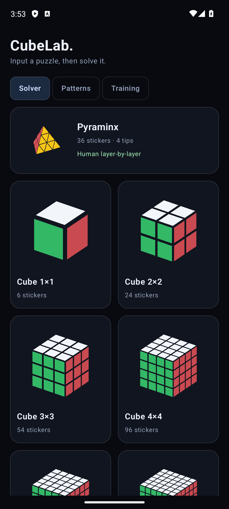
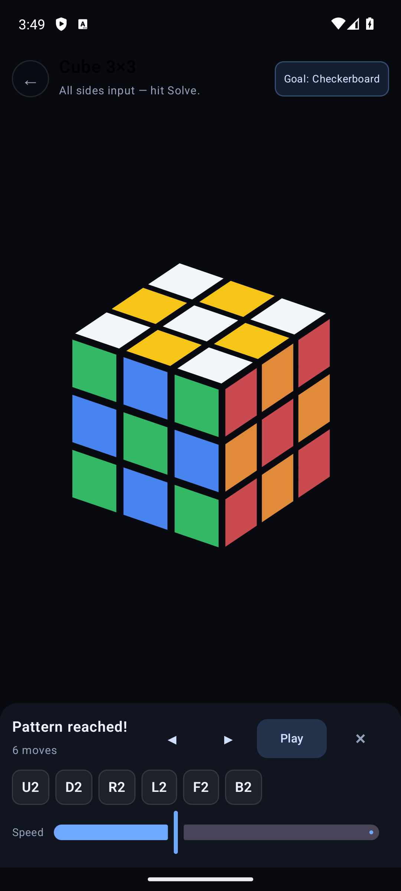

# CubeLab

[](https://github.com/0V3RR1DE0/cubelab/actions/workflows/ci.yml)

CubeLab is a native Android app for cube puzzles: input a real cube (or a
Pyraminx) sticker by sticker, get a searched solution, and watch it play back in
3D. Everything runs on device. There is no account, no analytics, and no
network access.

| Home | Pattern solved |
| --- | --- |
|  |  |

## Features

- **Cubes 1×1 – 7×7** and **Pyraminx**, drawn with a Compose Canvas renderer
  (orthographic 3D, per-layer turn animation, pinch zoom).
- **Real solvers**, not stored solution lists:
  - 2×2 Ortega, 3×3 layer-by-layer, Pyraminx layer-by-layer at solve time;
  - Kociemba two-phase search (tables in `app/src/main/assets/cube3.bin`) for
    3×3 target patterns and 2×2;
  - 4×4–7×7 reduction (centres, wings/midges, parity, reduced 3×3).
- **Input help**: palette fills the next free sticker, tap to select/replace,
  double-tap to clear, “Fill rest” completes a legal cube, and live diagnostics
  highlight impossible states.
- **Solve playback**: pause/resume, step forward/back, speed slider, current
  move label, highlighted step, curved turn arrow.
- **Patterns** for every size, custom target cubes saved locally, and a
  **training** tab with lessons, WCA-style timer (inspection, +2, DNF) and
  local Single/Ao5/Ao12/Mo3 results.
- **Camera sticker scanner** (CameraX) with manual correction; images never
  leave the device.

## Requirements

- Android 7.0+ (minSdk 24), targetSdk 36
- JDK 21, Android SDK platform 36 and build-tools 35.0.0
- Gradle is provided by the wrapper

## Build and test

```sh
cd native
./gradlew testDebugUnitTest
./gradlew assembleDebug
adb install -r app/build/outputs/apk/debug/app-debug.apk
adb shell am start -n cube.lab.app/cube.lab.nativeapp.MainActivity
```

`local.properties` (SDK path) is gitignored. If `ANDROID_HOME` is set, the build
finds the SDK without it.

The JVM suite covers random-scramble solves for every supported puzzle (2×2
through 7×7 and Pyraminx), pattern targets, colour-scheme inference, playback
semantics, scanner maths, and timer results.

## Release signing

Release signing is optional and never stored in the repo. The build reads:

| Setting | Environment variable | Gradle/local property |
| --- | --- | --- |
| keystore path | `CUBELAB_STORE_FILE` | `cubelab.storeFile` |
| store password | `CUBELAB_STORE_PASSWORD` | `cubelab.storePassword` |
| key alias | `CUBELAB_KEY_ALIAS` | `cubelab.keyAlias` |
| key password | `CUBELAB_KEY_PASSWORD` | `cubelab.keyPassword` |

If all four are present, `./gradlew assembleRelease` produces a signed APK;
otherwise release builds are unsigned. For local builds, put the properties in
`local.properties` or `~/.gradle/gradle.properties`.

### GitHub Actions

- **CI** (`.github/workflows/ci.yml`) runs on pushes and pull requests: unit
  tests, debug APK, and an internal test-build artifact. It can also be started
  manually from the Actions tab.
- **Release** (`.github/workflows/release.yml`) runs on a `v*` tag (or manually)
  and publishes a signed APK to a GitHub release. Configure these repository
  secrets first:

  - `CUBELAB_KEYSTORE_BASE64` — `base64 -w0 your-release.jks`
  - `CUBELAB_STORE_PASSWORD`
  - `CUBELAB_KEY_ALIAS`
  - `CUBELAB_KEY_PASSWORD`

```sh
git tag v2.3.0
git push origin v2.3.0
```

## Project layout

```
native/
  app/src/main/java/cube/lab/nativeapp/
    CubeEngine.kt      generic N×N facelets, moves, cubie model
    Kociemba.kt        two-phase 3×3 + 2×2 solver (loads cube3.bin)
    Human2.kt         2×2 Ortega
    Human3.kt         3×3 layer-by-layer
    HumanPyra.kt      Pyraminx layer-by-layer
    HumanBig4.kt      4×4 human reduction
    BigCube.kt        4×4–7×7 reduction solver
    Diagnose.kt       input validation and diagnostics
    AppState.kt       input flow, solve, playback, patterns, storage
    MainActivity.kt   Compose UI
    CubeRenderer.kt   cube renderer        PyraRenderer.kt  Pyraminx renderer
    FaceScanner*.kt   camera scanner       Training*.kt     lessons and timer
  app/src/main/assets/cube3.bin
  app/src/test/...    JVM tests
assets/               launcher icon sources
```

## License

MIT — see [LICENSE](LICENSE).
